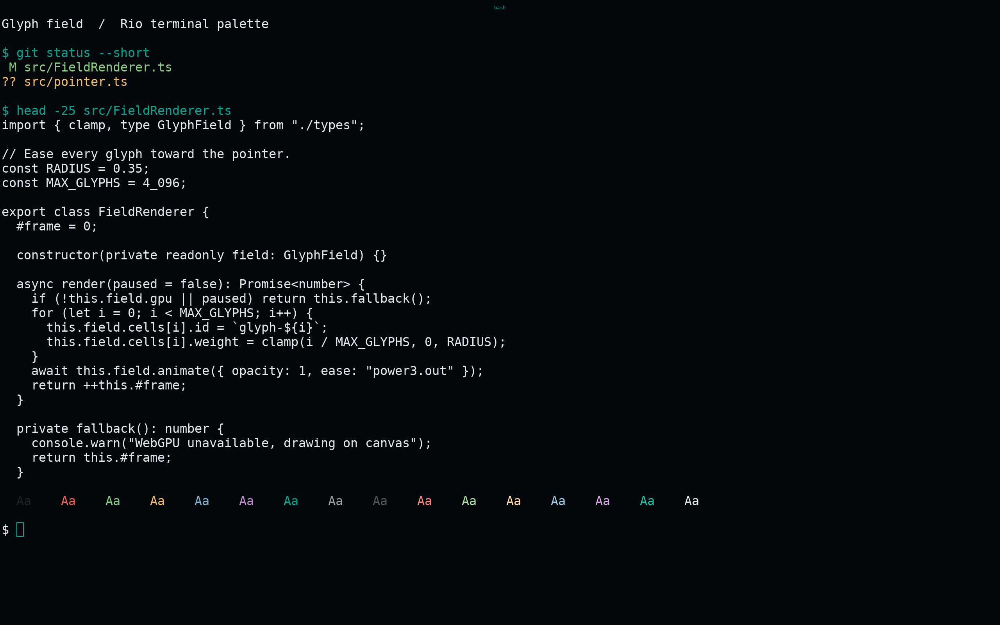
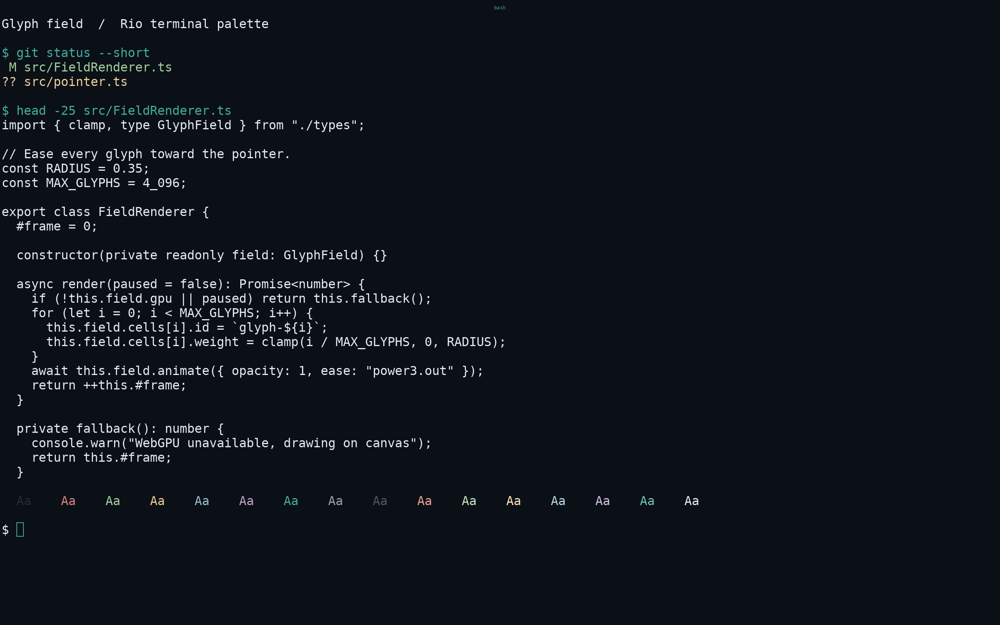
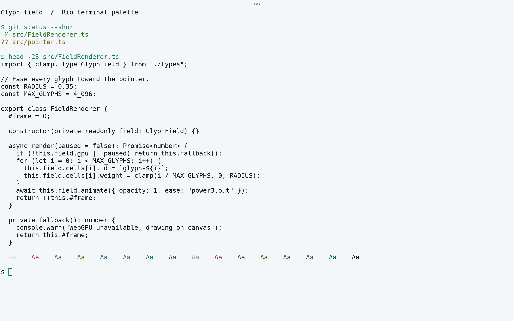
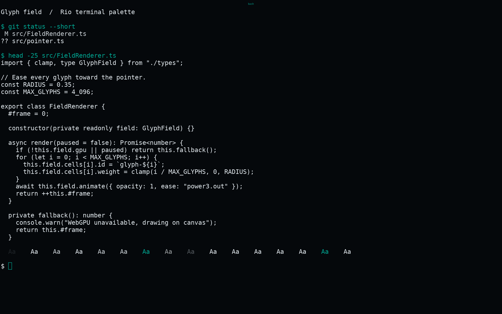

<!-- living-code-readme:1 -->
# 🏞️ Living Code for Rio

**Calm slate. Living color.** Living Code for Rio: native terminal palettes with all sixteen ANSI slots, cursor, selections, split dividers and search colors.

[Installation](#installation) · [Flavors](#flavors) · [Configuration](#configuration) · [All ports](https://github.com/living-code-theme)

## Previews

<table data-lc-flavors>
<tr>
<td width="50%" valign="top">
<strong>Night</strong><br><sub>Dark · full palette</sub><br><br>
<a href="images/night.png"></a>
</td>
<td width="50%" valign="top">
<strong>Frost</strong><br><sub>Dark · softer chroma</sub><br><br>
<a href="images/frost.png"></a>
</td>
</tr>
<tr>
<td width="50%" valign="top">
<strong>Paper</strong><br><sub>Light · near-white slate</sub><br><br>
<a href="images/paper.png"></a>
</td>
<td width="50%" valign="top">
<strong>Signal</strong><br><sub>Dark · teal accent</sub><br><br>
<a href="images/signal.png"></a>
</td>
</tr>
</table>

Select any preview to view the image at full size.

## Installation

```sh
flavor=night # night, frost, paper, or signal
curl -fsSL --create-dirs -o "${RIO_CONFIG_HOME:-${XDG_CONFIG_HOME:-$HOME/.config}/rio}/themes/living-code-$flavor.toml" "https://raw.githubusercontent.com/living-code-theme/rio/main/themes/living-code-$flavor.toml"
```

In Rio’s existing `config.toml`, set the top-level theme name **before any tables**:

```toml
theme = "living-code-night"
```

Reload or restart Rio. The download honors `RIO_CONFIG_HOME` and the Linux XDG config location. If your platform uses another Rio config directory, put `themes/` beside its `config.toml`. Existing renderer, font and shell settings stay untouched.

## Flavors

Expand a flavor for its full-size preview and activation instructions.

<details data-lc-flavor="night">
<summary><strong>Night</strong> · Dark · full palette</summary>

<p><a href="images/night.png"></a></p>

Set the top-level `theme = "living-code-night"` in Rio’s config, then reload or restart Rio.

</details>

<details data-lc-flavor="frost">
<summary><strong>Frost</strong> · Dark · softer chroma</summary>

<p><a href="images/frost.png"></a></p>

Set the top-level `theme = "living-code-frost"` in Rio’s config, then reload or restart Rio.

</details>

<details data-lc-flavor="paper">
<summary><strong>Paper</strong> · Light · near-white slate</summary>

<p><a href="images/paper.png"></a></p>

Set the top-level `theme = "living-code-paper"` in Rio’s config, then reload or restart Rio.

</details>

<details data-lc-flavor="signal">
<summary><strong>Signal</strong> · Dark · teal accent</summary>

<p><a href="images/signal.png"></a></p>

Set the top-level `theme = "living-code-signal"` in Rio’s config, then reload or restart Rio.

</details>

## Configuration

Each theme contains a native `[colors]` table. Rio names bright ANSI colors `light-black` through `light-white`, not `bright-*`. Cursor, vi cursor, tabs, active/inactive split dividers, selections, search matches and hints are all supplied. Remove conflicting `[colors]` entries from your main config if they override the selected theme.

## Compatibility

Verified against Rio’s native `Theme` and `Colors` structures at the pinned upstream revision. No terminal font, renderer, keybinding or shell setting is changed. These are static TOML themes and need no build tool at runtime. All ANSI slots are tested for order and exact agreement with the pinned palette.

Previews are captured programmatically from the actual application in an isolated profile. See [`capture/app.py`](capture/app.py) for the app-owned recipe and [`images/capture.json`](images/capture.json) for runtime, palette and image provenance. No mock interface is drawn.

## Contributing

Found a problem? [Open an issue](https://github.com/living-code-theme/rio/issues/new/choose) with the app version, the flavor and a screenshot. Want Living Code somewhere else? [Request a port](https://github.com/living-code-theme/core/issues/new?template=port-request.yml).

Pull requests are welcome. Keep this README, `port.json` and `images/` in sync, and use real screenshots of the app, never mockups.

🦎 **One chameleon, many habitats.** Part of [Living Code](https://github.com/living-code-theme).

## License

[MIT](LICENSE) © Elliot Luque
